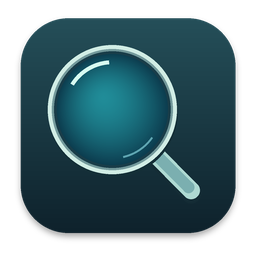

<p align="center">
  
</p>

<h1 align="center">MR-Linse</h1>
<p align="center"><strong>Kleine Details. Groß im Bild.</strong><br>Deine Soulear-Kamera als digitale Lupe am Mac.</p>
<p align="center">macOS 13+ · Apple Silicon · Swift / AppKit · ESP32-C3</p>

MR-Linse zeigt das Livebild einer kompatiblen Soulear-WLAN-Kamera in einer nativen Mac-Oberfläche. Mit einem **ESP32-C3 SuperMini als USB-Brücke** bleibt das WLAN deines Macs für das Internet frei. Alternativ verbindet sich der Mac direkt mit dem Kamera-WLAN.

**[Bedienungsanleitung als PDF](Docs/MR-Linse-Bedienungsanleitung.pdf)** · **[GitHub-Build und Upload](GITHUB.md)**

## Das kann MR-Linse

- **Rundes Livebild** mit automatischer Ausrichtung anhand der Kamerasensoren.
- **Digitaler Zoom von 1× bis 4×**, auch per Scrollen oder Trackpad-Geste am Mauszeiger.
- **Drehen und Spiegeln** für den passenden Blickwinkel.
- **Standbild per Leertaste** und Vollbildmodus.
- **JPEG-Fotos** als aktuelle Ansicht oder unverändertes Kameraoriginal.
- **Nativer Lichtschalter**, mit Abfrage und Rückmeldung der Kamera.
- **Automatische Wiederverbindung** nach Kamera- oder USB-Ausfall; bewusstes Stoppen beendet weitere Versuche.
- **Kameraprofile** mit einstellbarem WLAN-Namen und Kamera-IP.
- **Gespeicherte Optik-Einstellungen je Profil**: Zoom, Bildausschnitt, Spiegelung, Drehung und automatische Ausrichtung.
- **JPEG-Verarbeitung im Hintergrund**, mit begrenztem Bildpuffer und Anzeige der lokalen Verarbeitungszeit.
- **C3-Firmware direkt aus der App installieren und prüfen.** Bei passender Firmware verschwindet die Installationsschaltfläche.

## Voraussetzungen und aktueller Stand

| Komponente | Unterstützter Stand |
| --- | --- |
| Rechner | Mac mit Apple Silicon (M1 oder neuer) |
| Betriebssystem | macOS 13 oder neuer |
| Kamera | Die vorhandene Soulear/i4season-Kamera mit WLAN `Soulear-79144` |
| USB-Brücke | ESP32-C3 SuperMini mit USB-Datenkabel |
| GitHub-Paket | macOS ARM64, einschließlich ARM64-esptool und C3-Firmware |
| Windows / Linux | Noch nicht verfügbar; benötigen eine Portierung |

Andere Kameramodelle und Protokollvarianten sind nicht pauschal bestätigt. Unter **Kamera → Profil bearbeiten …** lassen sich Name, WLAN-Name und Kamera-IP speichern; **Als neues Profil** legt ein weiteres Profil an. Unterstützt sind weiterhin nur kompatible Soulear/i4season-Kameras mit offenem WLAN, keine beliebigen IP-Kameras.

**Für Version 0.3.0 einmalig die neue C3-Firmware über die App installieren.** Danach wird das Profil beim Verbinden über USB übertragen und auf dem C3 gespeichert. Ein neuer WLAN-Name erfordert kein erneutes Kompilieren mehr. Die App beginnt erst nach Bestätigung des Profils mit der Bildanzeige.

## Herunterladen und öffnen

Nach einem erfolgreichen GitHub-Build gibt es unter **Actions → Build MR-Linse → Artifacts** ein Paket mit der App und der separaten C3-Firmware. Bei einer neuen Versionsnummer erstellt der erfolgreiche Push-Build automatisch ein Release mit den Downloads.

1. `MR-Linse-macOS-arm64.zip` herunterladen und entpacken.
2. `MR-Linse.app` in den Ordner **Programme** ziehen und öffnen.
3. Falls macOS den Start blockiert, die Freigabe unter **Systemeinstellungen → Datenschutz & Sicherheit** prüfen. Die App ist ad-hoc signiert, aber nicht von Apple notarisiert.
4. Falls nach Zugriff auf das lokale Netzwerk gefragt wird, diesen erlauben.

## Schnellstart mit USB und C3

```text
Soulear-Kamera ── WLAN ── ESP32-C3 SuperMini ── USB ── Mac
                                                      │
                                              Heim-WLAN / Internet
```

1. Kamera einschalten und ihre Handy-App schließen, falls diese gerade verbunden ist.
2. C3 per USB-Datenkabel anschließen.
3. In MR-Linse unter **Verbindung** den Eintrag **USB · cu.usbmodem…** wählen.
4. Die Firmwareprüfung abwarten. Bei **Firmware aktuell** ist der C3 bereit.
5. Falls erforderlich, unter **Gerät** das Firmware-Installationssymbol anklicken und die Installation bestätigen.
6. Auf **Verbinden** klicken.

Der C3 verbindet sich selbstständig mit der Kamera; der Mac bleibt in seinem normalen WLAN. Eine Kamera-IP muss im USB-Modus nicht eingegeben werden.

> Die Firmwareinstallation ersetzt das vorhandene Programm auf dem C3. Währenddessen das USB-Kabel eingesteckt lassen. Auch die automatische Firmwareprüfung kann den C3 kurz neu starten.

## Alternative: direkt per WLAN

1. Mac mit **Soulear-79144** verbinden.
2. In MR-Linse **Kamera-WLAN** als Quelle wählen.
3. Auf **Verbinden** klicken. Die erkannte Kamera-Adresse erscheint unter **Gerät**.

Die Kamera ist normalerweise unter **192.168.1.1** erreichbar. Die Adresse des Heimrouters ist nicht die Kamera-Adresse. Über das Kamera-WLAN steht kein Internetzugang zur Verfügung.

## Bedienung

| Funktion | Bedienung |
| --- | --- |
| Zoom | Plus/Minus, Scrollen oder Trackpad-Vergrößerungsgeste; 1× bis 4× |
| Ausrichtung | **Auto-Drehung**, manuell in 90°-Schritten drehen oder horizontal spiegeln |
| Licht | Schiebeschalter **Kameralicht**; darunter steht der bestätigte Zustand |
| Standbild | Pause-Schaltfläche oder **Leertaste**; erneut drücken setzt das Livebild fort |
| Foto | Kamera-Symbol; **Aktuelle Ansicht** oder **Kameraoriginal** im Speicherdialog |
| Vollbild | Vollbild-Schaltfläche in der Werkzeugleiste |
| Verbindung beenden | **Livebild stoppen** bzw. **Verbindung beenden** |

**Aktuelle Ansicht** speichert Zoom, Drehung, Spiegelung und den runden Ausschnitt in einem quadratischen JPEG; außerhalb des Kreises ist das Bild schwarz. **Kameraoriginal** speichert das unveränderte JPEG der Kamera. Beide Varianten beziehen sich auf den Moment, in dem der Speicherdialog geöffnet wurde.

Die automatische Ausrichtung benötigt passende Sensordaten der Kamera. Nach dem ersten Bild fragt die App den Lichtzustand ab. **Zustand unbestätigt** bedeutet, dass keine Bestätigung eingetroffen ist; die App behauptet dann keinen neuen bestätigten Zustand.

Nach einem Verbindungsverlust versucht die App es mit zunehmendem Abstand (bis 15 Sekunden) erneut. Ein Klick auf **Verbindung beenden** beendet diese Versuche. Bei einem geänderten USB-Port wird nur ein eindeutig einzelnes erkanntes Espressif-Gerät automatisch gewählt; bei mehreren Geräten den richtigen Anschluss manuell auswählen.

Die Anzeige **Verarbeitung … ms** misst ab dem vollständigen JPEG-Empfang am Mac bis zur Übergabe an die Ansicht. Das ist **nicht** die gesamte Verzögerung von Kamerasensor, WLAN und Bildschirm. Ob die Übertragung am echten Gerät spürbar schneller ist, muss mit der Kamera geprüft werden.

## Wenn etwas nicht funktioniert

| Problem | Zuerst prüfen |
| --- | --- |
| Kein USB-Anschluss sichtbar | Datenfähiges Kabel verwenden, neu einstecken, andere Programme am seriellen Port schließen |
| USB verbunden, aber kein Bild | Kamera eingeschaltet? WLAN-Name im gewählten Profil korrekt? Handy-App geschlossen? |
| Keine Antwort im direkten WLAN-Modus | Mac im Kamera-WLAN? Quelle **Kamera-WLAN** gewählt? Lokaler Netzwerkzugriff erlaubt? |
| Firmware lässt sich nicht installieren | Richtigen Anschluss wählen; bei Bedarf **BOOT** halten, **RESET** kurz drücken, **BOOT** loslassen, Anschluss erneut auswählen |
| Bild steht still | Standbild aktiv? Leertaste drücken; bei Funkproblemen Abstand verringern und neu verbinden |

Mehr Details stehen in der [PDF-Anleitung](Docs/MR-Linse-Bedienungsanleitung.pdf).

## Updates

Im App-Menü **MR-Linse → Nach Updates suchen …** wird das neueste stabile öffentliche GitHub-Release geprüft. Optional lässt sich **Automatisch nach Updates suchen** aktivieren: Die Prüfung erfolgt beim App-Start, höchstens einmal täglich. Ohne Internet arbeitet die Kamera weiter; automatische Prüfungen zeigen keine Netzwerkfehler an.

Bei einer neuen Version erscheinen Änderungsnotizen und **Update herunterladen**. Der Download öffnet sich im Browser. Danach MR-Linse beenden, das ZIP entpacken und die App im Programme-Ordner ersetzen. Es erfolgt kein automatischer Austausch der laufenden App und kein automatisches Flashen des C3.

GitHub-Builds übernehmen das Repository automatisch. Für lokale Builds kann es mit `MR_UPDATE_REPOSITORY=Benutzer/Repository zsh SoulearLupe/build_app.sh` gesetzt oder in der App unter **Updatequelle …** eingetragen werden. Unterstützt werden öffentliche Repositories; Zugangstokens werden nicht benötigt oder eingebettet.

Für eine Veröffentlichung:

1. Version in `SoulearLupe/VERSION` erhöhen, beim nächsten Mal beispielsweise auf `0.3.1`.
2. Änderungsnotizen in `RELEASE_NOTES.md` aktualisieren.
3. Änderungen committen und auf `main` pushen.

GitHub erstellt nach erfolgreichem Build automatisch den passenden Tag und das Release mit App, Firmware und PDF. **Keine Tags oder Releases mehr von Hand anlegen.** Bereits vollständig veröffentlichte Versionen bleiben unverändert. Ein fehlgeschlagener Upload kann mit demselben Commit erneut gestartet werden. Pull Requests veröffentlichen nichts.

Neue Kameramodelle können später mit einer App-Version und bei Bedarf einer angepassten C3-Firmware ausgeliefert werden. Die Updatefunktion erweitert noch nicht die derzeitige Kamerakompatibilität.

## Selbst bauen

Benötigt werden auf einem Apple-Silicon-Mac die Xcode Command Line Tools bzw. Xcode mit Swift sowie Python und PlatformIO. Die folgenden Befehle gelten für die Repository-Wurzel mit dem Unterordner `SoulearLupe`:

```sh
python3 -m venv .pio-tools
source .pio-tools/bin/activate
python -m pip install 'platformio==6.1.18'
python -m platformio run --project-dir SoulearLupe/C3-Bruecke
zsh SoulearLupe/build_app.sh
```

Das Ergebnis ist **`MR-Linse.app`** in der Repository-Wurzel. `swift build` allein baut nur das Programm; `build_app.sh` verpackt zusätzlich Icon, Flash-Tool und Firmware.

Der [GitHub-Workflow](.github/workflows/build.yml) startet bei Push auf `main`/`master`, bei Pull Requests und manuell. Nur Builds auf `main`/`master` veröffentlichen automatisch. Er prüft Build, Firmwaredateien, Flash-Tool und Bundle-Signatur. Kamerabild, Übertragung und Flashen benötigen zusätzlich einen Test an echter Hardware.

## Projektstruktur

```text
.github/workflows/build.yml    Automatischer Build und Release-Downloads
Docs/                         PDF-Bedienungsanleitung
GITHUB.md                     Upload- und Build-Hinweise
SoulearLupe/
  Sources/SoulearLupe/         Native macOS-App
  C3-Bruecke/                 ESP32-C3-Firmware (PlatformIO)
  FlashResources/             Flash-Tool, Lizenz und Boot-Ressourcen
  Artwork/                    App-Icon
  Package.swift               Swift-Paket
  build_app.sh                App-Bundle erstellen
```

## Hintergrund

MR-Linse ist ein unabhängiges Projekt und nicht mit Soulear verbunden. Hinweise zur Protokollrecherche stehen in [NOTICE.md](SoulearLupe/NOTICE.md). Die Lizenz des mitgelieferten esptool liegt unter [FlashResources/esptool-LICENSE](SoulearLupe/FlashResources/esptool-LICENSE).
